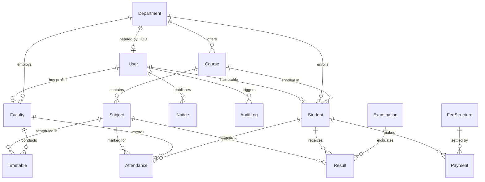

# Database Schema & Entity Relationships — College ERP

## 1. Architectural Philosophy
The database is built on **MongoDB + Mongoose** for a single engineering college serving **<1,000 students** across 6 academic departments.
All entities are modeled with strict validation, relational references (`ObjectId` + `ref`), and targeted indexes to ensure low latency and zero unnecessary microservices complexity.

---

## 2. Core Schemas & Entity Definitions

### 2.1 User Model (`User`)
- **Collection**: `users`
- **Purpose**: Unified institutional authentication credentials and role authorization.
- **Fields**:
  - `_id`: ObjectId (PK)
  - `name`: String (Required, max: 100)
  - `email`: String (Required, Unique, Lowercase, Indexed)
  - `password`: String (Required, Min: 6, `select: false`, Bcrypt hashed)
  - `role`: String (Enum: `super_admin`, `principal`, `hod`, `faculty`, `student`, `accounts`)
  - `department`: String (Optional, e.g. "Computer Science & Engineering")
  - `status`: String (Enum: `active`, `inactive`, `suspended`, Default: `active`)
  - `lastLogin`: Date (Timestamp of latest authenticated session)
  - `timestamps`: `createdAt`, `updatedAt`

### 2.2 Department Model (`Department`)
- **Collection**: `departments`
- **Fields**:
  - `name`: String (Required, Unique, e.g. "Computer Science & Engineering")
  - `code`: String (Required, Unique, Uppercase, e.g. "CSE")
  - `hod`: ObjectId -> `User` (Ref, Default: null)
  - `intakeCapacity`: Number (Default: 60, Range: 1-240)
  - `description`: String
  - `isActive`: Boolean (Default: true)

### 2.3 Course / Program Model (`Course`)
- **Collection**: `courses`
- **Fields**:
  - `name`: String (Required, e.g. "Bachelor of Technology in Computer Science")
  - `code`: String (Required, Unique, e.g. "BTECH-CSE")
  - `department`: ObjectId -> `Department` (Required, Indexed)
  - `degreeType`: String (Default: "B.Tech")
  - `durationSemesters`: Number (Default: 8, Range: 1-10)
  - `totalCredits`: Number (Default: 160)
  - `isActive`: Boolean (Default: true)

### 2.4 Subject / Curriculum Unit Model (`Subject`)
- **Collection**: `subjects`
- **Fields**:
  - `name`: String (Required, e.g. "Data Structures & Algorithms")
  - `code`: String (Required, Unique, e.g. "CS301")
  - `course`: ObjectId -> `Course` (Required, Indexed)
  - `department`: ObjectId -> `Department` (Indexed)
  - `semester`: Number (Required, Range: 1-8, Indexed)
  - `credits`: Number (Default: 3, Range: 1-6)
  - `isLab`: Boolean (Default: false)
  - `syllabusUrl`: String (Optional)

### 2.5 Student Profile (`Student`)
- **Collection**: `students`
- **Fields**:
  - `user`: ObjectId -> `User` (Required, Unique, Indexed)
  - `rollNumber`: String (Required, Unique, Uppercase, e.g. "24CSE042")
  - `enrollmentNumber`: String (Unique, Sparse)
  - `department`: ObjectId -> `Department` (Required, Indexed)
  - `course`: ObjectId -> `Course` (Required, Indexed)
  - `currentSemester`: Number (Required, Default: 1, Range: 1-8)
  - `batchYear`: String (Required, e.g. "2024-2028")
  - `guardianName`: String
  - `guardianPhone`: String
  - `admissionStatus`: String (Enum: `enrolled`, `graduated`, `suspended`, `withdrawn`)

### 2.6 Faculty Profile (`Faculty`)
- **Collection**: `faculties`
- **Fields**:
  - `user`: ObjectId -> `User` (Required, Unique, Indexed)
  - `employeeId`: String (Required, Unique, e.g. "FAC-CSE-001")
  - `department`: ObjectId -> `Department` (Required, Indexed)
  - `designation`: String (Enum: `Professor`, `Associate Professor`, `Assistant Professor`, `Lecturer`, `Lab Assistant`)
  - `qualification`: String (e.g. "Ph.D. in Computer Science")
  - `specialization`: String
  - `dateOfJoining`: Date (Default: now)

### 2.7 Timetable Slot Model (`Timetable`)
- **Collection**: `timetables`
- **Fields**:
  - `department`: ObjectId -> `Department`
  - `course`: ObjectId -> `Course`
  - `semester`: Number (1-8)
  - `section`: String (Default: 'A')
  - `dayOfWeek`: String (Enum: `Monday` to `Saturday`)
  - `periodNumber`: Number (1-8)
  - `startTime`: String (e.g. "09:00")
  - `endTime`: String (e.g. "09:50")
  - `subject`: ObjectId -> `Subject`
  - `faculty`: ObjectId -> `Faculty`
  - `roomNumber`: String
- **Compound Indexes**:
  - `{ dayOfWeek: 1, periodNumber: 1, roomNumber: 1 }` (Room conflict prevention)
  - `{ dayOfWeek: 1, periodNumber: 1, faculty: 1 }` (Faculty double-booking prevention)

### 2.8 Attendance Record (`Attendance`)
- **Collection**: `attendances`
- **Fields**:
  - `student`: ObjectId -> `Student` (Required)
  - `subject`: ObjectId -> `Subject` (Required)
  - `faculty`: ObjectId -> `Faculty` (Required)
  - `date`: Date (Required)
  - `periodNumber`: Number (Required, 1-8)
  - `status`: String (Enum: `present`, `absent`, `late`, `excused`)
  - `remarks`: String
- **Compound Unique Index**:
  - `{ student: 1, subject: 1, date: 1, periodNumber: 1 }` (Prevents duplicate entries)

### 2.9 Examination & Results Models (`Examination` & `Result`)
- **Collection**: `examinations`
  - `name`: String (e.g. "Mid-Term 1")
  - `examType`: String (Enum: `Mid-Term 1`, `Mid-Term 2`, `Semester End`, `Practical / Lab`, `Supplementary`)
  - `academicYear`: String (e.g. "2025-2026")
  - `semester`: Number (1-8)
  - `startDate`: Date, `endDate`: Date, `isPublished`: Boolean
- **Collection**: `results`
  - `examination`: ObjectId -> `Examination`
  - `student`: ObjectId -> `Student`
  - `subject`: ObjectId -> `Subject`
  - `internalMarks`: Number (0-40)
  - `externalMarks`: Number (0-60)
  - `totalMarks`: Number (0-100)
  - `grade`: String (`O`, `A+`, `A`, `B+`, `B`, `C`, `F`, `AB`)
  - `status`: String (`passed`, `failed`, `absent`, `withheld`)
  - **Index**: Unique `{ examination: 1, student: 1, subject: 1 }`

### 2.10 Fees & Payments Models (`FeeStructure` & `Payment`)
- **Collection**: `feestructures`
  - `title`: String
  - `department`: ObjectId -> `Department`
  - `academicYear`: String, `semester`: Number
  - `tuitionFee`, `labFee`, `libraryFee`, `examFee`, `otherFee`, `totalAmount`: Numbers
  - `dueDate`: Date
- **Collection**: `payments`
  - `student`: ObjectId -> `Student`
  - `feeStructure`: ObjectId -> `FeeStructure`
  - `receiptNumber`: String (Unique)
  - `amountPaid`: Number
  - `paymentDate`: Date
  - `paymentMethod`: String (`Cash`, `UPI`, `NetBanking`, `Card`, `DemandDraft`, `Cheque`)
  - `transactionReference`: String
  - `status`: String (`completed`, `pending`, `failed`, `refunded`)
  - `collectedBy`: ObjectId -> `User`

### 2.11 Circulars & System Audit Models (`Notice` & `AuditLog`)
- **Collection**: `notices`
  - `title`, `content`: Strings
  - `targetRoles`: Array of Strings (e.g. `['*']`, `['student', 'faculty']`)
  - `department`: ObjectId -> `Department` (Optional)
  - `priority`: String (`low`, `normal`, `urgent`)
  - `publishedBy`: ObjectId -> `User`
  - `isPinned`: Boolean
- **Collection**: `auditlogs`
  - `user`: ObjectId -> `User`
  - `action`: String (e.g. "USER_LOGIN", "MARKS_UPDATED")
  - `entityType`: String, `entityId`: String
  - `details`: Mixed
  - `ipAddress`: String, `userAgent`: String
